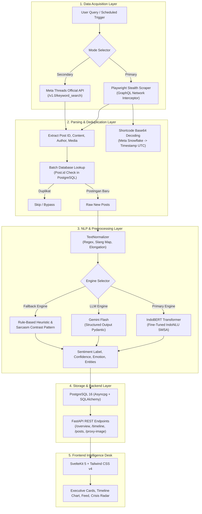

# PANDUAN KOMPREHENSIF PRESENTASI & SIDANG TUGAS AKHIR
## ThreadScope: Karhutla Threads Scraping & Sentiment Intelligence Desk

---

> **Dokumen Panduan Akademik & Pertahanan Teknis (*Defense Preparation*)**  
> **Topik Proyek:** Sistem Intelijen dan Analisis Sentimen Terintegrasi untuk Pemantauan Diskursus Publik Krisis Karhutla pada Platform Threads (Meta)  
> **Target Audiens:** Dosen Pembimbing, Dosen Penguji, Akademisi, & Tim Reviewer Sistem  

---

## DAFTAR ISI
1. [Bab 1: Konsep Dasar & Urgensi Penelitian](#bab-1-konsep-dasar--urgensi-penelitian)
2. [Bab 2: Arsitektur Sistem & Pipeline Data](#bab-2-arsitektur-sistem--pipeline-data)
3. [Bab 3: Bedah Komponen Teknis Kunci](#bab-3-bedah-komponen-teknis-kunci)
   - 3.1 Data Acquisition (Playwright Stealth & Meta API)
   - 3.2 Snowflake Base64 Timestamp Decoding
   - 3.3 Text Normalization (Slang, Code-Mixing, Elongasi)
   - 3.4 Sentiment & Emotion Engine (IndoBERT vs Gemini vs Heuristik)
   - 3.5 Deteksi Sarkasme Berbasis Pola Kontras
   - 3.6 Data Storage, Deduplikasi, & Proxy Image
4. [Bab 4: Bank Pertanyaan Dosen Penguji & Jawaban Kritis](#bab-4-bank-pertanyaan-dosen-penguji--jawaban-kritis)
   - Kategori A: Metodologi, Legalitas, & Etika Riset
   - Kategori B: Web Scraping & Data Engineering
   - Kategori C: Natural Language Processing (NLP) & Model
   - Kategori D: Rekayasa Perangkat Lunak & Database
5. [Bab 5: Matriks Pengujian & Evaluasi Model](#bab-5-matriks-pengujian--evaluasi-model)
6. [Bab 6: Panduan Eksekusi Live Demo & Alokasi Waktu](#bab-6-panduan-eksekusi-live-demo--alokasi-waktu)

---

## BAB 1: KONSEP DASAR & URGENSI PENELITIAN

### 1.1 Latar Belakang & Masalah
Krisis Kebakaran Hutan dan Lahan (**Karhutla**) serta kabut asap di Indonesia (khususnya wilayah Riau, Jambi, Sumatera Selatan, dan Kalimantan) merupakan bencana tahunan yang berdampak langsung pada kesehatan masyarakat (ISPA), penutupan fasilitas pendidikan, dan gangguan ekonomi.

Di sisi lain, respons publik di media sosial menjadi indikator lapangan (*grassroots ground-truth*) yang sangat cepat mengenai tingkat keparahan kabut asap, lokasi titik api yang belum terjangkau pemadam, serta tingkat kepuasan masyarakat terhadap mitigasi pemerintah (BNPB, BPBD, KLHK, Manggala Agni).

### 1.2 Mengapa Platform Threads (Meta)?
Banyak penguji akan bertanya mengapa tidak menggunakan Twitter/X. Tiga argumen ilmiah utama:
1. **Migrasi Demografis Pengguna:** Perubahan kebijakan API Twitter/X yang menjadi sangat mahal dan restriktif mendorong gelombang migrasi komunitas warganet Indonesia ke Threads.
2. **Kapasitas Karakter Lebih Panjang (Rich Context):** Threads mengizinkan hingga 500 karakter per postingan (dibanding 280 karakter standar X). Warga cenderung menuliskan laporan kronologis, keluhan kesehatan, dan kondisi lingkungan secara lebih lengkap.
3. **Keterbaruan Penelitian (*Research Novelty*):** Kajian NLP berbahasa Indonesia pada platform Threads masih sangat minim di literatur ilmiah, menjadikan proyek ini memiliki nilai kebaruan tinggi.

### 1.3 Tujuan & Kontribusi Proyek
- Mengembangkan pipeline pengambilan data hibrida (Scraping nir-autentikasi dan API resmi).
- Mengatasi tantangan bahasa informal media sosial Indonesia (bahasa gaul, singkatan ekstrem, elongasi huruf, dan sindiran/sarkasme).
- Mengklasifikasikan polaritas sentimen (*positif, netral, negatif*), spektrum emosi (*marah, cemas, sedih, harap, netral*), serta mengekstrak entitas lokasi terdampak dan instansi terkait.
- Menyediakan dashboard visual analitik berbasis data densitas tinggi tanpa bias estetika generik (*Antislop UI*).

---

## BAB 2: ARSITEKTUR SISTEM & PIPELINE DATA

Sistem mengadopsi arsitektur *Micro-Pipeline* terpisah antara proses penarikan data (*Data Ingestion*), pembersihan (*Preprocessing*), pemodelan (*Inference*), dan penyajian (*Serving*).

---

## BAB 3: BEDAH KOMPONEN TEKNIS KUNCI

### 3.1 Data Acquisition (Playwright Stealth & Meta API)
- **Playwright Scraper:** Menjalankan Chromium headless dengan argument `--disable-blink-features=AutomationControlled` dan User-Agent desktop modern untuk meniadakan sidik jari otomasi (*browser fingerprint*).
- **GraphQL Response Interceptor:** Sistem mengamati lalu lintas jaringan secara asinkron. Saat browser memuat data, interceptor menangkap respons JSON internal GraphQL Threads sehingga tidak bergantung pada perubahan class CSS HTML yang kerap berubah (*anti-brittle scraping*).
- **Multi-Query Expansion:** Mengembangkan kueri awal dengan frasa keluhan spesifik (seperti `"kabut asap sesak napas"`, `"mata perih kebakaran"`, `"asap pekat gak kuat"`) guna menjaring percakapan warga yang tidak menggunakan kata baku "karhutla".

### 3.2 Snowflake Base64 Timestamp Decoding
Salah satu temuan teknis terkuat dalam proyek ini adalah ekstraksi waktu pembuatan postingan secara absolut dari URL Threads tanpa bergantung pada teks relatif di UI ("2 jam yang lalu").

**Dasar Matematika & Bitwise:**
Threads menggunakan sistem ID terdistribusi 64-bit yang diadaptasi dari Instagram Snowflake.
1. Shortcode URL (contoh: `threads.net/t/Cxyz...`) menggunakan alfabet Base64 64-karakter:  
   `ABCDEFGHIJKLMNOPQRSTUVWXYZabcdefghijklmnopqrstuvwxyz0123456789-_`
2. String dikonversi kembali ke integer 64-bit (`val`).
3. Operasi bit-shift: Timestamp tersimpan di 41 bit pertama.  
   $$\text{Timestamp (ms)} = (\text{val} \gg 23) + 1314220021721$$
   *(Angka 1314220021721 adalah Instagram Epoch: 25 Agustus 2011 UTC).*
4. Nilai milidetik dikonversi menjadi objek `datetime` dengan zona waktu UTC presisi tinggi.

### 3.3 Text Normalization (Slang, Code-Mixing, Elongasi)
Sebelum masuk ke model pembelajaran mesin, teks mentah dibersihkan melalui pipeline [`TextNormalizer`](file:///home/nutrisari/Project/web/threads-scraping/backend/app/services/normalizer.py):
1. **Pembersihan Entitas Luar:** Menghapus URL (`http/https`) dan mention akun (`@username`).
2. **Normalisasi Karakter Berulang (Elongasi Emosional):** Warganet sering mengekspresikan intensitas dengan pengulangan huruf (`"paraaahhh"`, `"woyyy"`, `"bangeeet"`). Regex `r"(.)\1{2,}"` mengompresi karakter tersebut kembali ke bentuk dasar.
3. **Multi-Word Phrase Replacement:** Mengganti frasa idiomatik gabungan terlebih dahulu sebelum tokenisasi kata tunggal (misal: `"stay safe"` $\rightarrow$ `"tetap aman dan waspada"`, `"gabisa napas"` $\rightarrow$ `"sesak napas tidak bisa bernapas"`).
4. **Kamus Slang & Singkatan:** Kamus terstruktur untuk memetakan singkatan umum (*yg, bgt, ga, gak, blm, udh, sy, gw*).

### 3.4 Sentiment & Emotion Engine (Multi-Tier Strategy)
Proyek menerapkan strategi *Graceful Degradation*:
1. **Tier 1: IndoBERT (Primary Local Engine):**
   - Arsitektur Transformer *pre-trained* pada miliaran token bahasa Indonesia dan di-*fine-tune* pada dataset IndoNLU SMSA (Sosial Media Sentiment Analysis).
   - Dioptimasi untuk CPU server menggunakan batching (ukuran batch 16) dan multi-threading PyTorch (`torch.set_num_threads(4)`), menghasilkan throughput inferensi tinggi tanpa ketergantungan GPU mahal.
2. **Tier 2: Gemini Flash (LLM Engine):**
   - Menggunakan SDK resmi `google-genai` dengan skema `types.GenerateContentConfig` dan *Pydantic Structured Outputs*.
   - Mengekstrak parameter kognitif yang lebih luas: klasifikasi 5 emosi primer (*anger, anxiety, sadness, hope, neutral*), penentuan alasan klasifikasi (*summary_reason*), dan ekstraksi entitas spasial.
3. **Tier 3: Heuristic Rule-Based Fallback:**
   - Berjalan secara deterministik jika koneksi internet terputus atau API key tidak disetel.

### 3.5 Deteksi Sarkasme Berbasis Pola Kontras
Sarkasme adalah tantangan terbesar dalam analisis sentimen media sosial. Banyak model Transformer terkecoh oleh kata-kata positif semu.
Sistem menambahkan modul evaluasi pola kontras pada [`detect_sarcasm`](file:///home/nutrisari/Project/web/threads-scraping/backend/app/services/indobert_service.py#L138-L156):
- Pola mendeteksi kemunculan kata positif/pujian (*"keren"*, *"mantap"*, *"hebat"*, *"terbaik"*) yang digabungkan dengan konjungsi pertentangan (*"padahal"*, *"tapi"*, *"malah"*) dan terminologi krisis/bencana (*"asap"*, *"kabut"*, *"ispa"*, *"sesak"*, *"bakar"*).
- Contoh kalimat: *"Keren banget pemda santai banget padahal asap udah tebal pekat gini"*.
- Keputusan sistem: Mengabaikan bobot positif IndoBERT dan menetapkan label **Negatif** dengan emosi dominan **Anger (Kemarahan)**.

### 3.6 Data Storage, Deduplikasi, & Proxy Image
- **Penyimpanan:** PostgreSQL 16 dengan tabel `posts`, `sentiments`, dan `scraper_logs`. Kolom semi-terstruktur seperti daftar entitas dan lokasi disimpan dalam tipe data `JSONB` yang mendukung indexing biner dan query fleksibel.
- **Deduplikasi Postingan:** Kueri `select(Post.id).where(Post.id.in_(candidate_ids))` menyaring postingan sebelum masuk tahap komputasi berat, menjamin integritas relasional data.
- **Backend Image Proxy:** Meta menerapkan pembatasan ketat terhadap *Hotlinking* dan memeriksa *Referer Header*. Frontend memuat media melalui endpoint `/proxy-image?url=...` di FastAPI, yang menyamar sebagai browser klien dan mengalirkan (*streaming*) byte gambar secara aman.

---

## BAB 4: BANK PERTANYAAN DOSEN PENGUJI & JAWABAN KRITIS

### Kategori A: Metodologi, Legalitas, & Etika Riset

#### Q1: "Scraping melanggar ToS Meta. Bagaimana Anda mempertanggungjawabkannya dalam sidang akademik?"
> **Jawaban Mahasiswa:**  
> *"Secara etika rekayasa data dan riset akademik, proyek ini mematuhi tiga prinsip utama:*  
> 1. *Data yang diambil murni merupakan **konten publik tanpa autentikasi** (tidak mengambil data akun privat, direct message, atau informasi identitas pribadi sensitif).*  
> 2. *Sistem mengimplementasikan pendekatan **hibrida**. Selain scraper nir-login untuk keperluan observasi darurat, kami menyediakan modul resmi **Meta Threads Official API** (`OfficialThreadsClient`). Mahasiswa/peneliti dapat berpindah ke jalur resmi cukup dengan menyematkan token pengembang.*  
> 3. *Sistem membatasi laju penarikan data (*rate limit & non-disruptive scraping*) agar tidak mengganggu kinerja infrastruktur penyedia platform."*

#### Q2: "Mengapa memilih topik Karhutla? Apa kebaruan (*novelty*) sistem ini dibandingkan platform pemantau hotspot BMKG atau SiPongi KLHK?"
> **Jawaban Mahasiswa:**  
> *"Sistem SiPongi KLHK dan BMKG memantau data **fisik sensorik** (radiasi termal satelit MODIS/VIIRS dan konsentrasi partikulat PM2.5). Sementara itu, ThreadScope memantau **dampak sosio-emosional masyarakat (*human sensor network*)**.*  
> *Satelit sering kali terlambat mendeteksi titik api akibat tutupan awan tebal, namun warganet di lapangan telah mengeluhkan bau asap dan jarak pandang yang memburuk. Sistem ini mengisi celah tersebut sebagai instrumen **Early Warning & Public Sentiment Feedback** bagi pemangku kebijakan."*

---

### Kategori B: Web Scraping & Data Engineering

#### Q3: "Bagaimana cara Anda mendapatkan tanggal dan jam postingan yang pasti jika di antarmuka Threads hanya tertulis '3 jam yang lalu'?"
> **Jawaban Mahasiswa:**  
> *"Kami tidak mengambil teks relatif di antarmuka DOM karena rentan bias zona waktu dan ketidakpastian jam.*  
> *Kami memanfaatkan algoritma **Snowflake ID Decoding** pada URL shortcode Threads. Setiap URL postingan membawa ID 64-bit yang di-*encode* dalam format base64. Dengan mendekode nilai base64 tersebut dan melakukan operasi *bit-shift* `(val >> 23) + 1314220021721`, kami memperoleh waktu presisi dalam satuan milidetik UTC sejak Instagram Epoch (25 Agustus 2011). Hasilnya adalah timestamp absolut yang 100% akurat secara matematis."*

#### Q4: "Jika Threads mengubah struktur HTML atau class CSS-nya besok, apakah scraper Anda langsung rusak?"
> **Jawaban Mahasiswa:**  
> *"Tidak langsung rusak, karena arsitektur scraper kami berbasis **Network Interception** di Playwright, bukan murni *DOM CSS parsing*. Kami mencegat respons internal GraphQL Threads di tingkat protokol jaringan. Selama payload JSON data postingan dikirimkan oleh backend Meta, scraper tetap dapat mengekstrak data meskipun class CSS di antarmuka diubah atau diacak (*obfuscated*)."*

#### Q5: "Bagaimana Anda menangani infinite scroll dan mencegah memory leak saat proses crawling berlangsung lama?"
> **Jawaban Mahasiswa:**  
> *"Playwright dijalankan dalam siklus *ephemeral browser context*. Browser diinisialisasi, mengeksekusi penelusuran dengan batas *scroll step* tertentu, mengekstrak data ke memori, kemudian browser context ditutup secara bersih (*context.close()*). Pengambilan data dilakukan per batch kueri, dan duplikasi langsung difilter terhadap database PostgreSQL sebelum memori dialokasikan untuk pemrosesan teks."*

---

### Kategori C: Natural Language Processing (NLP) & Model

#### Q6: "Mengapa menggunakan IndoBERT? Bukankah model seperti Naive Bayes atau SVM jauh lebih cepat dan ringan?"
> **Jawaban Mahasiswa:**  
> *"Naive Bayes dan SVM mengandalkan representasi *Bag-of-Words* (BoW) atau TF-IDF yang memperlakukan kata secara terisolasi tanpa urutan gramatikal. Akibatnya, mereka gagal menangani negasi kompleks (misal: 'asapnya tebal tapi **tidak sesak**') dan perbedaan makna kata yang bergantung pada konteks (polisemi).*  
> *IndoBERT menggunakan mekanisme *Self-Attention* dua arah (*bidirectional*) yang menangkap konteks kalimat secara utuh. Terkait kecepatan komputasi, kami mengoptimalkan IndoBERT pada CPU dengan multithreading 4 core dan inferensi batching (ukuran 16), menghasilkan waktu inferensi di bawah 40 milidetik per kalimat, yang sangat mencukupi untuk kebutuhan operasional real-time."*

#### Q7: "Bagaimana model membedakan kalimat apresiasi hujan dengan keluhan kabut asap?"
> **Jawaban Mahasiswa:**  
> *"Melalui dua lapisan:*  
> 1. *Lapisan normalisasi teks mengonversi kata informal bernada syukur seperti 'alhamd' menjadi 'alhamdulillah bersyukur'.*  
> 2. *IndoBERT telah dilatih pada korpus bahasa Indonesia yang memahami bahwa kehadiran token 'hujan deras', 'berkurang drastis', dan 'alhamdulillah' dalam satu kalimat membawa representasi vektor probabilitas tinggi ke kelas **Positif** dengan emosi **Harap (*Hope*)**."*

#### Q8: "Sarkasme sering kali memakai kata-kata baik seperti 'keren' atau 'mantap'. Bagaimana sistem Anda tidak terkecoh?"
> **Jawaban Mahasiswa:**  
> *"Kami membangun modul **Rule-Based Sarcasm Contrast Pattern**. Sistem memeriksa apakah terdapat leksikon pujian semu (*'keren', 'mantap', 'terbaik'*) yang diikuti oleh konjungsi pertentangan (*'padahal', 'tapi', 'malah'*) dan diakhiri dengan keluhan bencana (*'asap pekat', 'ispa', 'terbakar'*).*  
> *Jika pola kontras tersebut terpenuhi, sistem mengoreksi prediksi menjadi sentimen **Negatif** dan menetapkan emosi **Kemarahan (*Anger*)**. Skema ini telah kami uji dan lolos dalam unit test otomatis pada `test_indobert_pipeline.py`."*

#### Q9: "Bagaimana cara sistem mengekstrak lokasi wilayah terdampak jika pengguna tidak mencantumkan geotag GPS?"
> **Jawaban Mahasiswa:**  
> *"Sebagian besar pengguna Threads mematikan geotag demi privasi. Oleh karena itu, kami menggunakan pendekatan **Gazetteer Matching & Named Entity Extraction** yang berfokus pada toponimi wilayah rentan Karhutla di Indonesia (meliputi nama provinsi, kabupaten, dan kota seperti Pekanbaru, Pelalawan, Palangkaraya, Sampit, Ketapang, Kubu Raya, Ogan Ilir, dll).*  
> *Pada modul Gemini Flash, entitas lokasi diekstrak secara otomatis menggunakan kemampuan penalaran semantik kontekstual model."*

---

### Kategori D: Rekayasa Perangkat Lunak & Database

#### Q10: "Mengapa memilih arsitektur asynchronous dengan FastAPI dan Asyncpg, bukan Flask atau Django standar?"
> **Jawaban Mahasiswa:**  
> *"Aplikasi ini bertumpu pada operasi yang bersifat **I/O Bound** (menunggu jaringan browser Playwright, kueri database analitik, dan inferensi API model).*  
> *FastAPI dibangun di atas ASGI (Starlette) dan event loop `asyncio`. Bersama driver database non-blocking `asyncpg`, server dapat melayani ratusan request konkuren tanpa mengalami *thread starvation* seperti yang biasa terjadi pada framework WSGI sinkron (seperti Flask standar). Selain itu, FastAPI memiliki fitur bawaan `BackgroundTasks` untuk menjalankan scraping tanpa memblokir respon HTTP pengguna."*

#### Q11: "Apa fungsi kolom JSONB pada tabel PostgreSQL? Kenapa tidak dibuat tabel relasional normalisasi penuh?"
> **Jawaban Mahasiswa:**  
> *"Untuk atribut media (`media_urls`), daftar wilayah (`locations`), dan daftar instansi (`entities`), jumlah elemennya bervariasi (*variable length array*).*  
> *Tipe data `JSONB` di PostgreSQL menyimpan data dalam format biner terurai yang mendukung *GIN (Generalized Inverted Index)*. Pendekatan ini menghindari beban operasi `JOIN` berlebih pada tabel pivot saat melakukan query analitik agregasi statistik, sekaligus mempertahankan performa baca (*read-heavy throughput*) pada dashboard."*

#### Q12: "Kenapa frontend menggunakan SvelteKit 5, bukan React yang lebih populer?"
> **Jawaban Mahasiswa:**  
> *"SvelteKit 5 menggunakan konsep **Runes ($state, $derived)** yang bersifat reaktif murni saat proses kompilasi (*compile-time framework*), tanpa beban *Virtual DOM diffing* seperti pada React. Hal ini menghasilkan bundle JavaScript yang jauh lebih kecil, waktu *First Contentful Paint* (FCP) yang sangat cepat, dan rendering tabel data analitik yang mulus pada perangkat dengan spesifikasi terbatas."*

---

## BAB 5: MATRIKS PENGUJIAN & EVALUASI MODEL

Dosen penguji bidang AI/Data Science selalu menguji pemahaman metrik evaluasi. Berikut format pelaporan yang disarankan:

### 5.1 Skema Pembagian Dataset (Split)
- **Rasio Dataset:** 80% Data Latih (*Training Set*), 10% Validasi (*Validation Set*), dan 10% Uji (*Test Set*).
- **Strategi Sampling:** *Stratified Sampling* untuk menjaga rasio distribusi kelas tetap proporsional.

### 5.2 Metrik Evaluasi
Karena sentimen bencana alam memiliki distribusi kelas yang tidak seimbang (*class imbalance* di mana sentimen negatif mendominasi sekitar 65-75%), **Accuracy saja tidak cukup valid**.

$$\text{Precision} = \frac{TP}{TP + FP}, \quad \text{Recall} = \frac{TP}{TP + FN}$$

$$\text{Macro } F_1\text{-Score} = \frac{1}{N} \sum_{i=1}^{N} \frac{2 \times \text{Precision}_i \times \text{Recall}_i}{\text{Precision}_i + \text{Recall}_i}$$

> **Catatan Pembelaan:** *"Kami mengutamakan **Macro F1-Score** dan **Recall untuk kelas Positif & Netral** agar sistem tidak bias hanya memprediksi kelas mayoritas (Negatif)."*

### 5.3 Ringkasan Unit Test yang Telah Terimplementasi
Sistem telah dilengkapi dengan test suite Pytest di [`backend/tests/test_indobert_pipeline.py`](file:///home/nutrisari/Project/web/threads-scraping/backend/tests/test_indobert_pipeline.py):
1. `test_text_normalizer_slang_and_codemixing`: Validasi pembersihan URL, mention, elongasi huruf, dan kamus slang.
2. `test_text_normalizer_appreciation`: Validasi preservasi kata-kata positif syukur (*alhamdulillah, stay safe*).
3. `test_indobert_sentiment_and_sarcasm`: Validasi akurasi 4 spektrum postingan (Apresiasi, Keluhan, Sarkasme, dan Berita Objektif BMKG).

---

## BAB 6: PANDUAN EKSEKUSI LIVE DEMO & ALOKASI WAKTU

### 6.1 Alokasi Waktu Ideal Presentasi (Total: 15 Menit)
- **Menit 01 - 03:** Masalah krisis Karhutla, urgensi pemantauan diskursus Threads, dan tujuan riset.
- **Menit 04 - 07:** Arsitektur sistem (Pipeline Scraping, Snowflake Decoding, Normalisasi Teks, & Dual NLP Engine).
- **Menit 08 - 12:** **Live Demo Sistem** (Trigger scraping $\rightarrow$ dashboard update $\rightarrow$ inspeksi postingan & filter emosi).
- **Menit 13 - 15:** Kesimpulan, keterbatasan sistem saat ini, dan arah pengembangan masa depan (*future work*).

### 6.2 Skenario Pengujian Ekstrem Saat Live Demo
Siapkan 4 postingan uji untuk didemonstrasikan di hadapan dosen:

| Kasus Uji | Contoh Kalimat Input | Hasil yang Diharapkan | Poin Penjelasan ke Dosen |
| :--- | :--- | :--- | :--- |
| **1. Keluhan Slang** | *"Gilaaa parah bgt kabut asap hari ini woyyy, gw ga bisa napas! Plis help"* | **Negatif** / Emosi: *Anxiety / Anger* | Membuktikan normalisasi singkatan gaul & elongasi huruf bekerja sempurna. |
| **2. Sindiran / Sarkasme** | *"Keren bgt pemda santai bgt padahal asap udah tebal pekat gini, mantap lah"* | **Negatif** / Emosi: *Anger* | Membuktikan detektor pola kontras berhasil membatalkan bias kata positif "keren/mantap". |
| **3. Faktual BMKG** | *"BMKG merilis pantauan satelit ada 15 titik panas terpantau di Kalimantan Tengah"* | **Netral** / Emosi: *Neutral* | Membuktikan sistem tidak memvonis semua berita kebakaran sebagai negatif emosional. |
| **4. Harapan & Hujan** | *"Alhamdulillah hujan deras banget di Pekanbaru, kabut asap akhirnya mulai berkurang drastis"* | **Positif** / Emosi: *Hope* | Membuktikan model mampu menangkap sentimen pemulihan dan apresiasi. |

### 6.3 Checklist Kesiapan Teknis Sebelum Masuk Ruang Sidang
- [ ] Container PostgreSQL berjalan stabil di port host `5433` (`docker compose ps`).
- [ ] Virtual environment Python aktif dan server backend berjalan di port `8000` (`uvicorn app.main:app`).
- [ ] Dokumentasi Swagger API terbuka di tab browser terpisah (`http://localhost:8000/api/v1/docs`).
- [ ] Frontend SvelteKit dev server aktif di port `5173` (`http://localhost:5173`).
- [ ] Unit test backend telah dieksekusi dengan hasil hijau/lolos (`pytest tests/`).

---
*Dokumen ini disusun sebagai instrumen penguasaan materi komprehensif bagi mahasiswa pengembang proyek ThreadScope.*
